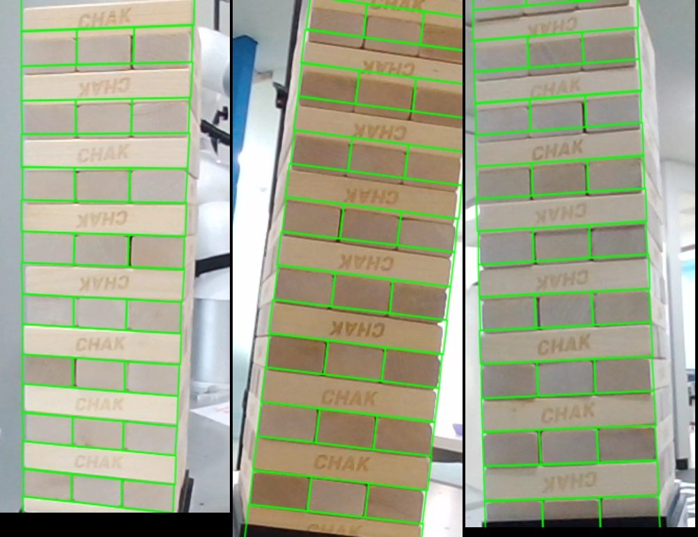
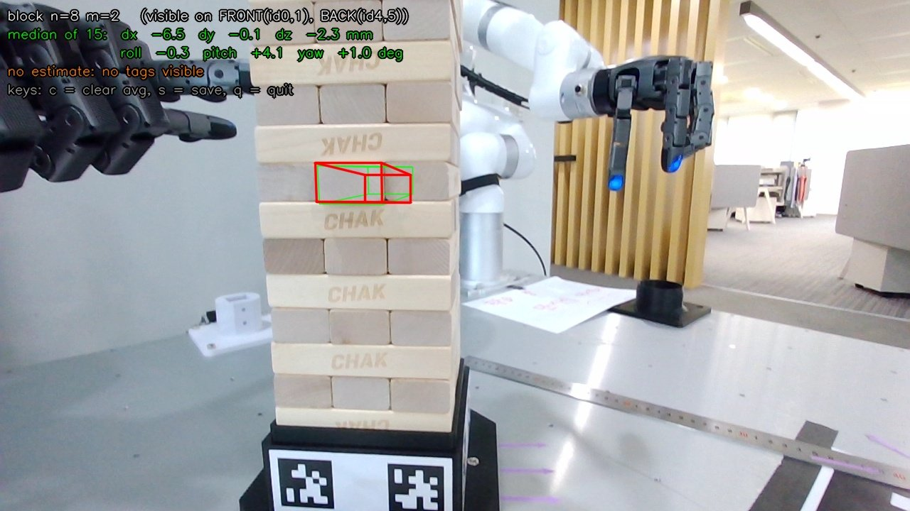

# JENGA_6DOF 진행 보고서 (2026-10-21 ~ 10-22)

> xArm7 ×2 + Allegro V6F ×2 젠가 시연에서, **n층 m번째 블록이 "깔끔하게 쌓은 기준 상태" 대비 얼마나 밀리고 돌아갔는지(6DOF)** 를 Orbbec Gemini 305 RGB-D 카메라로 추정하는 프로젝트. 이번 세션은 **손으로 카메라를 들고 측정하는 단계(M0~M2)** 까지 진행했다.

---

## 1. 한눈에 보기

| 항목 | 결과 |
|---|---|
| 도달 단계 | M0 카메라 → M1 캘리브레이션 → **M2 실시간 측정 + ROS2 발행 완료** (손 촬영) |
| 블록 밀기 (dx) | 실제 0 / 5 / 10 mm → 측정 **0 / 4.5 / 9.8 mm** (오차 ≤ 0.5 mm) |
| 블록 회전 (yaw, 바깥 블록) | 실제 −2.5° / −5.0° → 측정 **−2.0° / −4.4 ~ −5.5°** (오차 ≈ ±0.6°) |
| 옆 밀림 (dy, 바깥 블록) | 기대값 대비 **±1 mm** |
| 전 높이 커버리지 (2·16·17층) | 정리 상태에서 REL **±2 mm, ±2° 이내**, 측정 실패 없음 |
| 절대값 (기준 대비, ABS) | 아래층 ±1 mm, **위층 ±4~7 mm** (손으로 든 카메라의 태그 위치 오차) → 손목 장착(M3)에서 해결 예정 |
| 처리 속도 | 블록 1회 추정 약 100~270 ms (CPU) |


*기준 타워 캘리브레이션 결과: 모델의 층/블록 경계(초록)가 실제 틈과 1~2 px 이내로 일치.*


*실시간 화면: 초록 = 기준 위치, 빨강 = 추정 위치 (8층 2번 블록을 앞으로 뺀 상태, 초기 버전 화면).*

---

## 2. 목표와 전제

- **목표**: "n층 m번째 블록을 빼라" 명령 시, 그 블록이 기준 대비 얼마나 틀어졌는지(dx, dy, dz, roll, pitch, yaw)를 알아내 로봇에 전달.
- **핵심 아이디어**: 타워는 매번 깔끔하게 정리해서 시작하므로, **기준 자세는 하드코딩**하고 카메라로는 그 기준에서의 **편차만 보정**한다 (탐지 문제 → 보정 문제).
- **물리적 제약**: 블록은 아래층 위에 놓여 있으므로 z, roll, pitch는 거의 변하지 않는다. 실제로 변하는 것은 긴 방향 밀림(dx), 옆 밀림(dy), 수평 회전(yaw). → roll/pitch/dz는 강한 사전값(prior)으로 붙잡고, 검증용으로만 출력.

### 하드웨어 / 환경

| 항목 | 내용 |
|---|---|
| 카메라 | Orbbec Gemini 305 (USB, `2bc5:0840`), 컬러 1280×720 RGB, depth 1280×800, 프리셋 `Close Range High Accuracy` |
| 블록 | 약 115 × 38 × 23 mm (실측 fit 높이 **22.36 mm**), 17층, 층당 3개 밀착 |
| 지그 | 검은 박스(옆면 약 125 × 50 mm) 위에 타워, 1층은 지그 테두리에 반쯤 가려짐 |
| 태그 | AprilTag 36h11, 36 mm, 박스 네 옆면에 2개씩 띠(118 × 46 mm, 중심 간격 72 mm) |
| SW | Python 3.10 venv (`--system-site-packages`), pyorbbecsdk2 2.1.2, OpenCV 4.11, Open3D 0.18, ROS2 Humble |

### 좌표 / 번호 규칙

- **앞면** = 태그 id 0·1 띠가 붙은 면. 위에서 봤을 때 시계방향으로 오른쪽(id 2·3), 뒤(id 4·5), 왼쪽(id 6·7).
- **n** = 1(맨 아래) … 17. **홀수층**은 앞에서 긴 면이 보이고 m=1이 가장 앞. **짝수층**은 앞에서 끝면이 보이고 m=1이 왼쪽.
- **타워 좌표계**: 원점 = 타워 중심축 & 1층 바닥면, +x 오른쪽(앞에서 볼 때), +y 뒤쪽, +z 위.
- **블록 좌표계** (결과 delta의 기준): x = 긴 방향, y = 폭 방향, z = 위. 홀수층은 블록 +x = 타워 오른쪽, 짝수층은 블록 +x = 타워 뒤쪽.
  - 예: 짝수층 블록을 앞으로 빼면 dx가 음수. 홀수층 맨 앞 블록의 오른쪽 끝을 앞으로 당기면 yaw가 음수(위에서 볼 때 시계방향).

---

## 3. 진행 과정

### M0. 카메라 연결

1. venv 구성, `pyorbbecsdk2` 설치, USB udev 규칙 설치(sudo).
2. 컬러/depth 스트림 + color 정렬 depth 확인 (`tools/stream_check.py`).
3. 렌즈 왜곡 모델이 **8계수(rational, BROWN_CONRADY_K6)** 임을 발견 → 5계수만 쓰던 코드를 수정.

### M1-1. 태그 맵 캘리브레이션

- 손으로 타워를 한 바퀴 돌며 **두 면의 태그가 동시에 보이는 모서리 뷰**를 자동 저장 (`tools/calib_capture.py`, 43장).
- 각 면의 띠(태그 2개)를 강체로 보고, 카메라 자세 + 면 자세를 **번들 조정** (`tools/solve_tagmap.py`).

| 지표 | 값 |
|---|---|
| 재투영 RMS | **0.67 px** (최대 5.2 px) |
| 이웃 면 사이 각도 | 89.93 ~ 90.13° (기대 90°) |
| 마주보는 면 사이 각도 | 179.41 ~ 179.50° (기대 180°) |
| 마주보는 띠 평면 간격 | 130.7 / 131.6 mm (박스 폭 + 종이) |
| 면 순서 검증 | 2·3번 띠 = 오른쪽, 6·7번 띠 = 왼쪽 확인 |

### M1-2. 기준 타워 위치 맞추기

- **수평 위치·방향**: 타워가 지그에 끼워져 있으므로 네 띠 평면의 중심에서 바로 계산.
- **높이**: 정리된 타워를 45~50 cm에서 찍은 28장 중 20장으로, 층 사이 어두운 틈과 모델 층 경계가 맞아떨어지는 **1층 바닥 높이 z0와 블록 높이 h를 탐색** (`tools/fit_tower_ref.py`).

| 결과 | 값 | 비고 |
|---|---|---|
| 1층 바닥 높이 | 띠 중심 + **27.0 mm** (바닥에서 ≈ 50 mm) | 실측한 박스 높이 5 cm와 일치 |
| 블록 높이 | **22.36 mm** (공칭 23 mm) | 23 mm로 두면 17층에서 약 11 mm 누적 오차 |
| 탐색 프로파일 | 27 mm 근처 단일 피크 | 한 층 어긋남 같은 모호성 없음 |

### M2. 블록 6DOF 추정 + 실시간 도구

**추정 파이프라인** (`jenga6dof/estimator.py`):

1. **태그로 카메라 자세** (대략, mm 단위 오차).
2. **국소 보정**: 목표 층의 위아래 층(n±1, n±2) 바깥 면을 depth에 맞춰 카메라 자세를 보정. 목표 블록 중심을 회전 중심으로 하고, 보정 크기에 사전값(±6 mm, ±2°)을 둔다.
3. **블록 fit**: 목표 블록의 보이는 바깥 면에 대해
   - depth 점 → 면 거리 (면 테두리 5 mm는 제외),
   - 투영한 윤곽 위치의 이미지 밝기 기울기,
   - roll/pitch/dz 강한 사전값,
   을 IRLS(Huber)로 최소화. 마지막에 **면 법선 방향 오프셋은 depth만으로 다시 계산**.
4. **결과 2종**: REL(위아래 층 대비) / ABS(처음 기준 대비 = 국소 보정량까지 합친 값).
5. **신뢰도**: 보이는 면 종류(끝면만 / 옆면 포함 / 들어간 끝면)에 따라 실험으로 정한 1σ 하한을 적용.

**실시간 도구** (`tools/live_block.py`):

- 터미널에 `n m` 입력 → 화면에 기준(초록) / 추정(빨강) 윤곽, 좌상단에 ABS·REL 6DOF.
- 최근 15개 측정을 **축별 가중 중앙값**으로 합산 (예: yaw는 긴 옆면이 보이는 시점이 주도).
- 측정에 쓴 모든 프레임·depth·결과를 `data/live/<세션>/`에 **자동 녹화**, `label`로 이름표.
- **ROS2 발행**: `/jenga/block_pose`, `/jenga/block_nominal_pose` (PoseStamped, frame `jenga_tower`), `/jenga/block_delta`(ABS), `/jenga/block_delta_rel`(REL) (Float64MultiArray: `[n, m, dx, dy, dz(mm), roll, pitch, yaw(deg), 샘플 수, valid]`).

---

## 4. 정확도 결과

모든 실측은 손으로 들고 25~35 cm(위층은 40~45 cm), 15개 이상 합산 기준.

### 4.1 블록 밀기 — 8층 2번 (가운데 블록, 끝면만 보임)

| 실제 당김 | 1차 (구 설정, 자 대충) | 2차 (구 설정) | **최종 (새 센서 설정)** |
|---|---|---|---|
| 0 mm | −0.6 | −0.5 | **0.0** |
| 5 mm | −6.5 | −3.9 | **−4.5** |
| 10 mm | −9.4 | −7.8 | **−9.8** (앞 −9.8 / 뒤 −10.2 일치) |

최종: dx 오차 ≤ 0.5 mm, 나머지 축 dy/dz ±1.5 mm, 각도 ±2° 이내.

### 4.2 블록 회전 — 9층 1번 (바깥 블록, 긴 옆면 보임)

| 오른쪽 끝 당김 | 기대 yaw | 측정 yaw (정리 상태 대비) | 기대 dy | 측정 dy |
|---|---|---|---|---|
| 5 mm | −2.5° | **−2.0°** | −2.5 mm | −2.0 mm |
| 10 mm (1차) | −5.0° | −2.9° | −5 mm | −3.1 mm |
| 10 mm (재측정 2회) | −5.0° | **−4.4 ~ −5.5°** | −5 mm | **−4.0 ~ −4.8 mm** |

- 1차 10 mm는 depth 원본에서도 오른쪽 끝이 약 6 mm만 나와 있어, 실제로 덜 당겨진 것으로 판단 (재측정에서 기대값과 일치).
- 정리 상태에서 이 블록은 원래 약 −1.1° 틀어져 있었음 (depth 원본에서도 동일 기울기 확인).
- 재측정 시 자로 잰 왼쪽/오른쪽 끝 값은 **미수령** — 받으면 최종 비교 예정.

### 4.3 높이별 커버리지 (정리 상태 → 모두 0 근처가 정상)

| 블록 | 위치 | REL | ABS |
|---|---|---|---|
| 2층 2번 | 맨 아래 | dx +0.8, dy −0.5, dz −1.2 mm, 각도 ±0.5° | dx +0.7, dy −0.6, dz −1.2 mm ✅ |
| 8층 2번 | 중간 | 0.0 mm (밀기 테스트 기준점) | +2.9 mm (실제 타워가 이상적 수직보다 약 3 mm 뒤, 기준 사진에서도 동일) |
| 16층 2번 | 위 | dx −0.3, dy −0.1, dz −0.6 mm, yaw +1.7° | dx 앞에서 +6.9 / 뒤에서 −4.1 → **태그 오차** |
| 17층 1번 | 맨 위 | dx −1.0, dy −0.2, dz +0.1 mm, 각도 ±1° | dy +3.8 mm (시점별 흔들림) |

### 4.4 보이는 면에 따른 정확도 (기준 사진, 45~50 cm, 단일 프레임)

| 보이는 면 | dx | yaw |
|---|---|---|
| 끝면만 (38 mm 폭) | ±3.8 mm | ±6.7° |
| 끝면 + 긴 옆면 (115 mm) | ±2.1 mm | ±2.3° |

→ 끝면은 1° 돌아가도 양쪽 depth 차이가 0.66 mm뿐이라 yaw가 약하다. 긴 옆면은 같은 1°에 2 mm 차이. 여러 프레임 가중 합산 + 25~35 cm 근접으로 실측 정확도는 위 표(4.1~4.3)까지 개선.

### 4.5 블록 종류별 예상 오차 요약 (손 촬영, 합산 기준)

| 축 | 가운데 블록 (m=2) | 바깥 블록 (m=1, 3) | 근거 |
|---|---|---|---|
| dx (긴 방향) | **±1 mm** | ±1 mm (예상) | 가운데 실측, 바깥은 동일 원리 |
| dy (옆) | ±1.5 mm | **±1 mm** | 바깥 실측 |
| dz | ±1.5 mm | ±1.5 mm | 정리 상태 확인 |
| yaw | ±2° (실회전 미검증) | **±0.6~1°** | 바깥 실측 |
| roll / pitch | ±1~2° (사실상 "평평" 가정) | ±1~2° | 사전값 |
| ABS 추가 오차 | +±1 mm(아래층) ~ ±4~7 mm(위층) | 동일 | 태그 거리 |

---

## 5. 문제와 해결 과정

| # | 문제 | 원인 | 해결 |
|---|---|---|---|
| 1 | SDK가 카메라를 열지 못함 (`openUsbDevice failed`) | USB udev 규칙 미설치 | 규칙 파일 복사 + `udevadm` 재로드 (명령 줄바꿈으로 파일명 깨짐 → 짧게 나눠 실행) |
| 2 | 왜곡 보정 값이 이상함 (k1 = −1.08) | Gemini 305는 8계수 rational 모델인데 5계수만 사용 | OpenCV rational 순서(k1,k2,p1,p2,k3,k4,k5,k6)로 8계수 사용 |
| 3 | 박스 옆면 높이가 5 cm라 60 mm 태그 불가 | 지그 크기 | 36 mm 태그 2개를 한 띠로 → 띠 내부 간격이 인쇄로 고정되어 정확도도 향상 |
| 4 | depth와 태그 기반 모델이 면마다 ±5 mm 불일치 | 45~50 cm에서 작은 태그의 자세 오차 + depth 노이즈 | **위아래 층 면으로 카메라 자세 국소 보정** (태그 오차·depth 편향 상쇄) |
| 5 | 국소 보정이 발산 (10~250 mm) | 카메라 원점 기준 회전 → 타워에서 큰 이동, 반복적인 틈/각인에 엉뚱하게 맞춤 | 회전 중심을 목표 블록으로, 보정은 depth만, 사전값으로 크기 제한 |
| 6 | roll/pitch가 50° 이상 튐 | Huber loss가 사전값 항까지 약화 | **IRLS**: robust 가중치는 데이터 항에만, 사전값은 제곱 그대로 |
| 7 | 이미지 경계선 검출 실패 | 조명 때문에 블록 틈 대비가 약하고, 각인/배경이 더 강하게 잡힘 | 이진 경계 대신 **투영 윤곽 위치의 법선 방향 밝기 기울기**, 흐림→선명 2단계 |
| 8 | 블록을 뺄수록 pitch가 커짐 (4~6°) | 튀어나온 끝면 **위쪽 테두리 depth가 뒤쪽 면과 섞임** (위에서 내려다봐서 비대칭) | 면 테두리 **5 mm 제외**하고 가운데만 사용 → pitch 3.7° → 1.2° |
| 9 | 측정값이 실제의 70~80% | (a) 경계선 항이 "블록이 타워로 들어가는 선"에 끌림 (b) **센서가 작은 단차를 뭉갬** | (a) 법선 방향 오프셋은 depth만으로 재계산 (b) **depth 1280×800 + `Close Range High Accuracy` 프리셋** → 10 mm가 9.8 mm로 |
| 10 | 뒤에서 본 값이 크게 틀림 (10 mm → 4 mm, yaw +10°) | 블록 끝이 **안쪽으로 들어간 구멍**은 한쪽 벽에 가려 depth가 비대칭 | 들어간 끝면만 보이는 측정은 신뢰도 하향 (dx ±4 mm, yaw ±10°) |
| 11 | 합산 시 엉뚱한 yaw가 섞임 | 계산상 1σ(Jacobian)가 실제보다 너무 작음 | 실험으로 정한 **보이는 면 종류별 1σ 하한** + 축별 가중 중앙값 |
| 12 | 위아래 층이 같이 밀리면 측정에서 사라짐 (사용자 지적) | 국소 보정이 이웃 층을 기준으로 가정 | 국소 보정량을 버리지 않고 **ABS(기준 대비)와 REL(이웃 대비)로 분리** 출력. 태그 오차는 시점마다 달라 합산 시 상쇄, 실제 이동은 남음 |
| 13 | 저장 사진이 쓸모없음 (`s` 누르러 가는 사이 카메라 이동) | 수동 저장 | 측정에 쓴 **모든 프레임 자동 녹화** + `label`, 사후 재분석 도구(`tools/analyze_session.py`) |

---

## 6. 층 높이에 따른 정확도

| 구간 | REL (이웃 대비) | ABS (기준 대비) | 이유 |
|---|---|---|---|
| 아래층 (2~5층) | ±1~2 mm | **±1 mm 수준** | 태그와 가까워 카메라 자세가 정확 |
| 중간층 (6~12층) | ±1 mm, ±1~2° | ±2~3 mm | 태그와 블록을 한 화면에 담으려면 거리가 늘어남 |
| 위층 (13~17층) | ±1~2 mm, ±2° | **±4~7 mm** (시점별 부호 반대) | 40~45 cm로 물러나야 태그가 보임 → 태그 자세 오차 증가, 기준 층이 아래쪽에만 있음 |

- REL은 전 높이에서 안정적. ABS는 **태그(맨 아래)와 블록 사이 거리에 비례해 나빠짐** — 손 촬영 구조의 한계.
- 손으로 쌓은 "정리 상태"도 수 mm 수준으로 완벽하게 곧지 않다 (예: 8층 부근 약 3 mm 뒤쪽). ABS의 "0"은 이상적인 수직 타워 기준.

### 개선 아이디어

**손 촬영 단계에서 (필요할 때만)**

- **기준 상태 재캡처 테이블**: 시연 시작 전 정리된 타워를 한 번 훑어 블록별 실제 위치를 저장하고, 이상적 모델 대신 그 값을 0으로 사용 → "정리 상태의 자연스러운 휘어짐(±3 mm)" 제거.
- **중간 높이 기준점 추가**: 타워 옆에 고정된 기둥/스탠드에 태그를 붙여 위층 근처에서도 큰 태그가 보이게 → 위층 ABS 개선.
- **가운데 블록 yaw**: 앞/뒤 끝면의 옆 위치를 함께 쓰는 다중 시점 결합 → ±1° 목표.
- **다중 프레임 공동 최적화**: 지금은 프레임별 추정 후 합산 → 여러 프레임의 점/경계를 한 번에 fit.

**로봇 장착 후 (M3)**

- 카메라 자세를 **로봇 FK + hand-eye**로 → ABS의 태그 오차 제거 (예상 1~2 mm).
- 블록별 **촬영 자세 계획**: 바깥 블록은 모서리 방향(긴 면 + 끝면), 가운데 블록은 빠져나오는 쪽 끝면을 25~30 cm에서.
- 마름모 배치로 왼팔/오른팔이 블록 양 끝을 동시에 볼 수 있음 → yaw·dx 동시 강화.

---

## 7. 앞으로 할 일

1. **로봇 쪽과 합의**
   - 허용 오차: "블록 위치가 몇 mm / 몇 도까지 틀려도 손으로 잡을 수 있나" → 개선 필요 여부 판단 기준.
   - 인터페이스: 지금처럼 토픽 연속 발행 vs "n층 m번 재 줘" 요청-응답(ROS2 서비스).
2. **M3 손목 장착** (마운트 3D 프린팅 후)
   - hand-eye 캘리브레이션, FK 기반 카메라 자세, 촬영 자세 계획, 태그는 보조로 유지.
3. **남은 확인**
   - yaw 10 mm 재측정 시 자로 잰 양 끝 값 받아 최종 비교.
   - 홀수층 블록을 옆면(오른쪽/왼쪽)에서 본 밀기 테스트, 가운데 블록 실제 회전 테스트 (필요 시).

---

## 8. 사용법

```bash
# 환경 (최초 1회)
python3 -m venv --system-site-packages .venv
.venv/bin/pip install -r requirements.txt
sudo cp .venv/lib/python3.10/site-packages/pyorbbecsdk/shared/99-obsensor-*.rules /etc/udev/rules.d/
sudo udevadm control --reload && sudo udevadm trigger      # 그 후 카메라 USB 재연결

# 태그 PDF (100% 크기로 인쇄)
.venv/bin/python tools/make_tag_pdf.py

# 캘리브레이션 (태그를 다시 붙였거나 지그가 움직였을 때)
.venv/bin/python tools/calib_capture.py          # 모서리 4곳 각 10장 이상
.venv/bin/python tools/solve_tagmap.py           # -> config/tagmap.yaml
.venv/bin/python tools/stream_check.py data/ref  # 정리된 타워 정면/모서리 촬영 (s)
.venv/bin/python tools/fit_tower_ref.py          # -> config/tower_ref.yaml

# 실시간 측정
.venv/bin/python tools/live_block.py             # 터미널: "n m", "label X", "c", "s", "q"

# 녹화 세션 재분석
.venv/bin/python tools/analyze_session.py data/live/<세션> [...]
```

## 9. 파일 구조

```
config/tower.yaml          기준 타워 정의 (블록 치수, 층 수, 번호 규칙, 태그)
config/tagmap.yaml         태그 맵 (면 4개의 상대 자세)
config/tower_ref.yaml      태그 맵 -> 타워 좌표, fit 블록 높이
jenga6dof/camera.py        Gemini 305 래퍼 (프리셋, depth 해상도, color 정렬)
jenga6dof/tower_model.py   (n, m) -> 기준 4x4 자세
jenga6dof/tagmap.py        태그 띠 기하, 검출, 번들 조정
jenga6dof/localize.py      태그로 카메라 자세, 태그 맵 -> 타워 좌표
jenga6dof/estimator.py     블록 6DOF 추정 (국소 보정 + 블록 fit + 신뢰도)
jenga6dof/ros_pub.py       ROS2 발행
tools/                     PDF 생성, 캘리브레이션, 실시간 측정, 평가/분석 스크립트
tags/                      인쇄용 태그 PDF
docs/                      이 보고서 (md / html)
```
